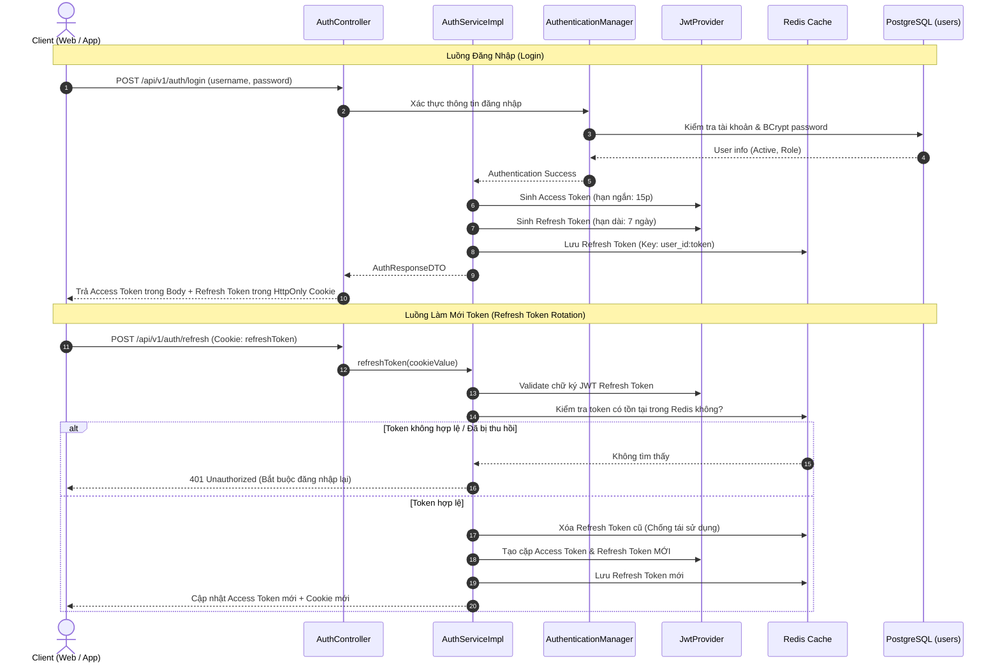
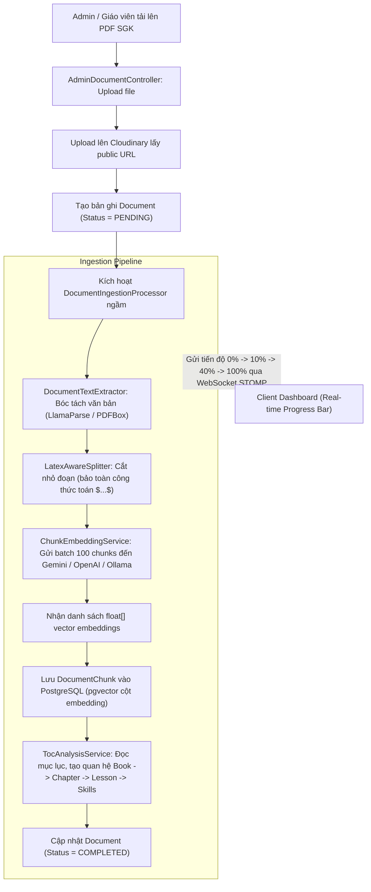
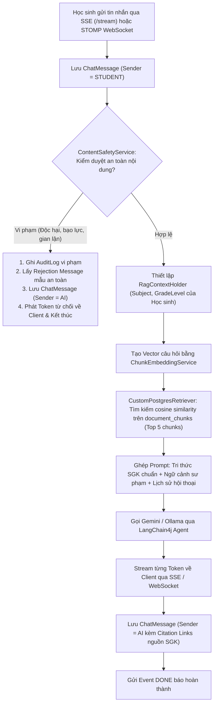
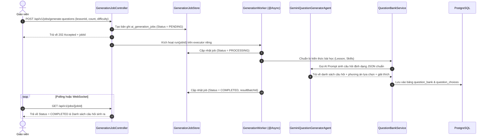
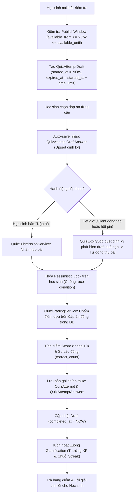
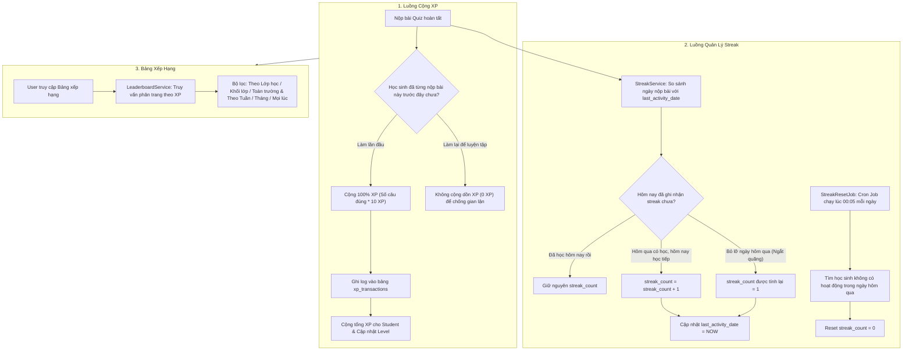
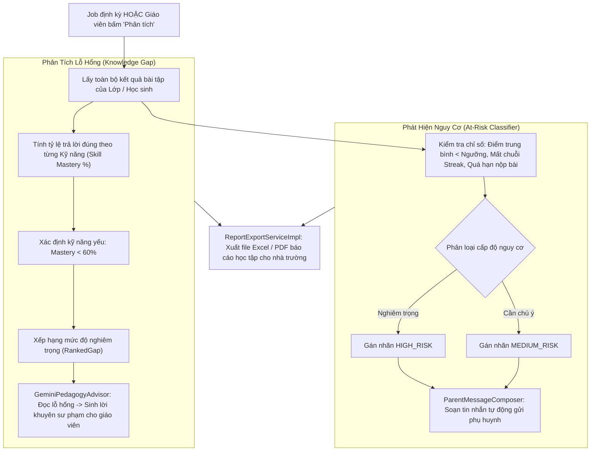
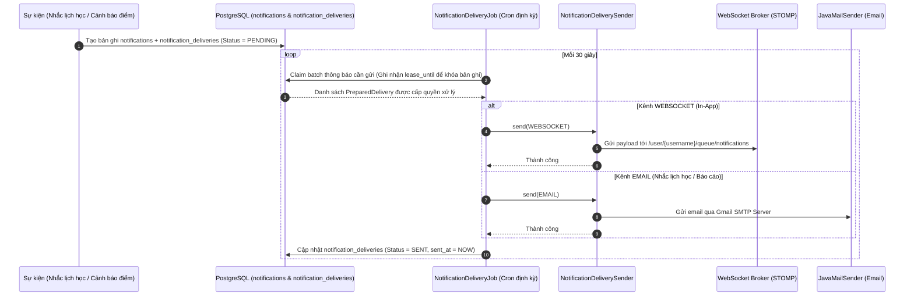
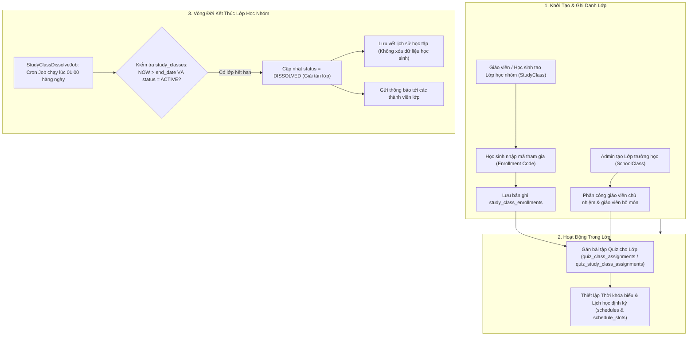

# Tài Liệu Luồng Chức Năng Hệ Thống (Functional Flow Documentation) - AI Tutor Service

Tài liệu này tổng hợp toàn bộ luồng hoạt động (functional workflows), kiến trúc dữ liệu và tương tác giữa các thành phần trong dự án **`ai-tutor-service`** (Spring Boot 3.x, PostgreSQL pgvector, Redis, RabbitMQ, LangChain4j, Gemini/Ollama).

---

## 1. Tổng Quan Kiến Trúc Toàn Cục (System Architecture)

```mermaid
flowchart TD
    subgraph Clients["Tầng Client & Người Dùng"]
        Student["Học sinh (Web / Mobile)"]
        Teacher["Giáo viên (Web Dashboard)"]
        Admin["Quản trị viên (Admin Portal)"]
    end

    subgraph Gateway_Security["Tầng Bảo Mật & Kết Nối (Security & Transport)"]
        JWT["Spring Security + JWT Authentication"]
        RateLimit["Rate Limiting Filter (Bucket4j / Redis)"]
        WS_STOMP["WebSocket / STOMP Relay (RabbitMQ)"]
        SSE["Server-Sent Events (SSE Streaming)"]
    end

    subgraph Core_Services["Tầng Dịch Vụ Nghiệp Vụ (Application Services)"]
        AuthSvc["Auth & User Profile Service"]
        ChatSvc["Chat & Content Safety Service"]
        CurriculumSvc["Curriculum & Ingestion Service"]
        QuizSvc["Quiz & Question Bank Service"]
        GamificationSvc["Gamification (XP, Streak, Leaderboard)"]
        AnalyticsSvc["Analytics, At-Risk & Pedagogy Advisor"]
        NotifSvc["Notification & Delivery Engine"]
    end

    subgraph Background_Workers["Tầng Xử Lý Nền (Background Workers & Jobs)"]
        IngestWorker["Document Ingestion Processor"]
        GenWorker["AI Question Generation Worker"]
        CronJobs["Schedulers (Streak, Quiz Expiry, At-Risk, Notif Delivery)"]
    end

    subgraph Data_AI_Layer["Hạ Tầng Dữ Liệu & AI"]
        Postgres[("PostgreSQL 16 + pgvector<br/>(Dữ liệu quan hệ + Vector SGK)")]
        Redis[("Redis 7.2<br/>(Cache, Token Blacklist, Lock)")]
        RabbitMQ["RabbitMQ 3.13<br/>(STOMP Broker & Message Queue)"]
        Cloudinary["Cloudinary<br/>(Lưu trữ File & Avatar)"]
        LLM_APIs["AI APIs (Google Gemini / Ollama / OpenAI)"]
    end

    Clients --> Gateway_Security
    Gateway_Security --> Core_Services
    Core_Services --> Background_Workers
    Core_Services --> Data_AI_Layer
    Background_Workers --> Data_AI_Layer
```

---

## 2. Chi Tiết Luồng Từng Chức Năng

### Chức Năng 1: Xác Thực & Quản Lý Phiên (Authentication & Token Rotation)

- **Mục đích:** Xử lý đăng ký, đăng nhập an toàn với cơ chế JWT kép: Access Token trong HTTP Authorization Header và Refresh Token trong `HttpOnly Cookie`. Áp dụng cơ chế xoay vòng token (Token Rotation) và blacklist token trên Redis khi đăng xuất.
- **Mã nguồn liên quan:**
  - Controller: [`AuthController.java`](file:///d:/aaa/AI-tutor-/ai-tutor-service/src/main/java/com/vn/aitutor/controller/AuthController.java)
  - Service: [`AuthServiceImpl.java`](file:///d:/aaa/AI-tutor-/ai-tutor-service/src/main/java/com/vn/aitutor/service/user/AuthServiceImpl.java)
  - Security/JWT: [`JwtProvider.java`](file:///d:/aaa/AI-tutor-/ai-tutor-service/src/main/java/com/vn/aitutor/security/jwt/JwtProvider.java), [`RefreshTokenService.java`](file:///d:/aaa/AI-tutor-/ai-tutor-service/src/main/java/com/vn/aitutor/security/jwt/RefreshTokenService.java), [`TokenBlacklistService.java`](file:///d:/aaa/AI-tutor-/ai-tutor-service/src/main/java/com/vn/aitutor/security/jwt/TokenBlacklistService.java)

---

### Chức Năng 2: Nạp & Vector Hóa Tài Liệu Giáo Trình (Curriculum & RAG Ingestion Pipeline)

- **Mục đích:** Xử lý file PDF sách giáo khoa tải lên từ Admin/Giáo viên. Tự động bóc tách bằng LlamaParse, phân đoạn thông minh bảo toàn công thức Toán dạng LaTeX, tạo vector embeddings theo batch và lưu vào `pgvector`. Đồng thời phân tích mục lục (TOC) để tạo cấu trúc: Sách -> Chương -> Bài -> Kỹ năng.
- **Mã nguồn liên quan:**
  - Controller: [`AdminDocumentController.java`](file:///d:/aaa/AI-tutor-/ai-tutor-service/src/main/java/com/vn/aitutor/controller/AdminDocumentController.java)
  - Processor: [`DocumentIngestionProcessor.java`](file:///d:/aaa/AI-tutor-/ai-tutor-service/src/main/java/com/vn/aitutor/service/curriculum/DocumentIngestionProcessor.java)
  - Splitter: [`LatexAwareSplitter.java`](file:///d:/aaa/AI-tutor-/ai-tutor-service/src/main/java/com/vn/aitutor/curriculum/LatexAwareSplitter.java)
  - Parser/TOC: [`BookExtractionService.java`](file:///d:/aaa/AI-tutor-/ai-tutor-service/src/main/java/com/vn/aitutor/service/curriculum/BookExtractionService.java), [`TocAnalysisService.java`](file:///d:/aaa/AI-tutor-/ai-tutor-service/src/main/java/com/vn/aitutor/service/curriculum/TocAnalysisService.java)
  - Embedding: [`ChunkEmbeddingService.java`](file:///d:/aaa/AI-tutor-/ai-tutor-service/src/main/java/com/vn/aitutor/ai/client/ChunkEmbeddingService.java)

---

### Chức Năng 3: Gia Sư AI Tương Tác Trực Tuyến (RAG AI Chatbot Streaming)

- **Mục đích:** Cung cấp trải nghiệm hỏi đáp học tập thời gian thực với Gia sư AI. Hệ thống tích hợp bộ lọc an toàn nội dung (`ContentSafetyService`), trích xuất tri thức bám sát SGK từ `pgvector` thông qua ngữ cảnh lớp/môn của học sinh, và stream phản hồi theo token kèm trích dẫn tài liệu tham khảo.
- **Mã nguồn liên quan:**
  - Controller: [`ChatController.java`](file:///d:/aaa/AI-tutor-/ai-tutor-service/src/main/java/com/vn/aitutor/controller/ChatController.java), [`ChatWebSocketController.java`](file:///d:/aaa/AI-tutor-/ai-tutor-service/src/main/java/com/vn/aitutor/controller/ChatWebSocketController.java)
  - Processor: [`ChatStreamProcessor.java`](file:///d:/aaa/AI-tutor-/ai-tutor-service/src/main/java/com/vn/aitutor/service/chat/ChatStreamProcessor.java)
  - Guardrail: [`ContentSafetyService.java`](file:///d:/aaa/AI-tutor-/ai-tutor-service/src/main/java/com/vn/aitutor/service/chat/ContentSafetyService.java)
  - RAG Retriever: [`CustomPostgresRetriever.java`](file:///d:/aaa/AI-tutor-/ai-tutor-service/src/main/java/com/vn/aitutor/service/chat/CustomPostgresRetriever.java)
  - AI Agent: [`AiTutorChatAgent.java`](file:///d:/aaa/AI-tutor-/ai-tutor-service/src/main/java/com/vn/aitutor/ai/agent/AiTutorChatAgent.java)

---

### Chức Năng 4: Sinh Đề Tự Động & Quản Lý Ngân Hàng Câu Hỏi (AI Question Bank)

- **Mục đích:** Giáo viên yêu cầu sinh câu hỏi trắc nghiệm hoặc tự luận theo bài học và ma trận độ khó. Tác vụ được đưa vào hàng đợi xử lý bất đồng bộ (Async Worker), gọi LLM sinh câu hỏi có cấu trúc, tự động điền vào Ngân hàng đề thi và cho phép gán đề thi cho lớp học.
- **Mã nguồn liên quan:**
  - Controller: [`GenerationJobController.java`](file:///d:/aaa/AI-tutor-/ai-tutor-service/src/main/java/com/vn/aitutor/controller/GenerationJobController.java), [`QuestionBankController.java`](file:///d:/aaa/AI-tutor-/ai-tutor-service/src/main/java/com/vn/aitutor/controller/QuestionBankController.java)
  - Worker: [`GenerationWorker.java`](file:///d:/aaa/AI-tutor-/ai-tutor-service/src/main/java/com/vn/aitutor/service/job/GenerationWorker.java), [`GenerationJobService.java`](file:///d:/aaa/AI-tutor-/ai-tutor-service/src/main/java/com/vn/aitutor/service/job/GenerationJobService.java)
  - Agent: [`GeminiQuestionGeneratorAgent.java`](file:///d:/aaa/AI-tutor-/ai-tutor-service/src/main/java/com/vn/aitutor/ai/agent/GeminiQuestionGeneratorAgent.java)
  - Services: [`QuestionBankService.java`](file:///d:/aaa/AI-tutor-/ai-tutor-service/src/main/java/com/vn/aitutor/service/quiz/QuestionBankService.java), [`QuizManagementService.java`](file:///d:/aaa/AI-tutor-/ai-tutor-service/src/main/java/com/vn/aitutor/service/quiz/QuizManagementService.java)

---

### Chức Năng 5: Chu Trình Làm Bài Kiểm Tra & Chấm Điểm (Quiz Lifecycle & Auto-Grading)

- **Mục đích:** Đảm bảo tính trung thực và toàn vẹn khi học sinh làm bài: kiểm tra khung thời gian xuất bản (`PublishWindow`), tạo bản nháp lưu đáp án theo thời gian thực (tránh mất bài khi mất mạng), tự động thu bài khi hết giờ (`QuizExpiryJob`) và chấm điểm tức thời.
- **Mã nguồn liên quan:**
  - Controller: [`StudentQuizAttemptController.java`](file:///d:/aaa/AI-tutor-/ai-tutor-service/src/main/java/com/vn/aitutor/controller/StudentQuizAttemptController.java)
  - Service: [`QuizSubmissionService.java`](file:///d:/aaa/AI-tutor-/ai-tutor-service/src/main/java/com/vn/aitutor/service/quiz/QuizSubmissionService.java), [`QuizGradingService.java`](file:///d:/aaa/AI-tutor-/ai-tutor-service/src/main/java/com/vn/aitutor/service/quiz/QuizGradingService.java), [`QuizAccessService.java`](file:///d:/aaa/AI-tutor-/ai-tutor-service/src/main/java/com/vn/aitutor/service/quiz/QuizAccessService.java)
  - Expiry Job: [`QuizExpiryJob.java`](file:///d:/aaa/AI-tutor-/ai-tutor-service/src/main/java/com/vn/aitutor/config/QuizExpiryJob.java)

---

### Chức Năng 6: Hệ Thống Động Lực Học Tập & Gamification (XP, Streak, Leaderboard)

- **Mục đích:** Thúc đẩy thói quen học tập hàng ngày của học sinh qua hệ thống điểm kinh nghiệm XP (chỉ thưởng lần đầu làm bài để chống gian lận), duy trì chuỗi học liên tục (Daily Streak), tự động reset lúc 00:00 và xếp hạng cạnh tranh.
- **Mã nguồn liên quan:**
  - Controller: [`LeaderboardController.java`](file:///d:/aaa/AI-tutor-/ai-tutor-service/src/main/java/com/vn/aitutor/controller/LeaderboardController.java)
  - Gamification Services: [`XpAwardService.java`](file:///d:/aaa/AI-tutor-/ai-tutor-service/src/main/java/com/vn/aitutor/service/gamification/XpAwardService.java), [`StreakService.java`](file:///d:/aaa/AI-tutor-/ai-tutor-service/src/main/java/com/vn/aitutor/service/gamification/StreakService.java), [`LeaderboardService.java`](file:///d:/aaa/AI-tutor-/ai-tutor-service/src/main/java/com/vn/aitutor/service/gamification/LeaderboardService.java)
  - Audit/Reset Job: [`StreakResetJob.java`](file:///d:/aaa/AI-tutor-/ai-tutor-service/src/main/java/com/vn/aitutor/config/StreakResetJob.java), [`XpIntegrityAuditService.java`](file:///d:/aaa/AI-tutor-/ai-tutor-service/src/main/java/com/vn/aitutor/service/gamification/XpIntegrityAuditService.java)

---

### Chức Năng 7: Phân Tích Lỗ Hổng Kiến Thức, Cảnh Báo Sớm & Cố Vấn Sư Phạm (Analytics & AI Pedagogy)

- **Mục đích:** Tự động tính toán mức độ thành thạo từng kỹ năng/chuyên đề dựa trên lịch sử làm bài. Phát hiện học sinh có nguy cơ tụt lại phía sau (At-risk), gọi AI cố vấn sư phạm (`GeminiPedagogyAdvisor`) để gợi ý lộ trình cải thiện và soạn thư tự động gửi phụ huynh.
- **Mã nguồn liên quan:**
  - Controller: [`AnalyticsController.java`](file:///d:/aaa/AI-tutor-/ai-tutor-service/src/main/java/com/vn/aitutor/controller/AnalyticsController.java)
  - Jobs: [`KnowledgeGapAnalysisJob.java`](file:///d:/aaa/AI-tutor-/ai-tutor-service/src/main/java/com/vn/aitutor/config/KnowledgeGapAnalysisJob.java), [`AtRiskScanJob.java`](file:///d:/aaa/AI-tutor-/ai-tutor-service/src/main/java/com/vn/aitutor/config/AtRiskScanJob.java)
  - Services: [`KnowledgeGapServiceImpl.java`](file:///d:/aaa/AI-tutor-/ai-tutor-service/src/main/java/com/vn/aitutor/service/analytics/KnowledgeGapServiceImpl.java), [`AtRiskServiceImpl.java`](file:///d:/aaa/AI-tutor-/ai-tutor-service/src/main/java/com/vn/aitutor/service/analytics/AtRiskServiceImpl.java), [`ParentMessageServiceImpl.java`](file:///d:/aaa/AI-tutor-/ai-tutor-service/src/main/java/com/vn/aitutor/service/analytics/ParentMessageServiceImpl.java), [`ReportExportServiceImpl.java`](file:///d:/aaa/AI-tutor-/ai-tutor-service/src/main/java/com/vn/aitutor/service/analytics/ReportExportServiceImpl.java)
  - AI Advisor: [`GeminiPedagogyAdvisor.java`](file:///d:/aaa/AI-tutor-/ai-tutor-service/src/main/java/com/vn/aitutor/ai/advisor/GeminiPedagogyAdvisor.java)

---

### Chức Năng 8: Động Cơ Gửi Thông Báo Đa Kênh Tin Cậy (Notification Engine)

- **Mục đích:** Xử lý gửi thông báo nhắc lịch học trước giờ lên lớp, thông báo kết quả thi, cảnh báo phụ huynh qua WebSocket (In-App) và Email (SMTP). Thiết kế theo mô hình `Claim & Lease Lock` đảm bảo không bao giờ gửi lặp thông báo khi triển khai nhiều pod/instance.
- **Mã nguồn liên quan:**
  - Controller: [`NotificationController.java`](file:///d:/aaa/AI-tutor-/ai-tutor-service/src/main/java/com/vn/aitutor/controller/NotificationController.java)
  - Reminder: [`ClassReminderService.java`](file:///d:/aaa/AI-tutor-/ai-tutor-service/src/main/java/com/vn/aitutor/service/system/notification/ClassReminderService.java), [`ScheduleNotificationJob.java`](file:///d:/aaa/AI-tutor-/ai-tutor-service/src/main/java/com/vn/aitutor/config/ScheduleNotificationJob.java)
  - Delivery: [`NotificationDeliveryJob.java`](file:///d:/aaa/AI-tutor-/ai-tutor-service/src/main/java/com/vn/aitutor/config/NotificationDeliveryJob.java), [`NotificationDeliverySender.java`](file:///d:/aaa/AI-tutor-/ai-tutor-service/src/main/java/com/vn/aitutor/service/system/notification/NotificationDeliverySender.java), [`NotificationDeliveryStore.java`](file:///d:/aaa/AI-tutor-/ai-tutor-service/src/main/java/com/vn/aitutor/service/system/notification/NotificationDeliveryStore.java)

---

### Chức Năng 9: Quản Lý Lớp Học & Tự Động Giải Tán (Classroom Lifecycle)

- **Mục đích:** Quản lý hai loại hình lớp: Lớp trường học chính khóa (`SchoolClass`) và Lớp học nhóm ngắn hạn (`StudyClass`). Cung cấp mã tham gia lớp (Enrollment code), phân công bài tập, và định kỳ giải tán lớp học nhóm đã hết hạn.
- **Mã nguồn liên quan:**
  - Controller: [`StudyClassController.java`](file:///d:/aaa/AI-tutor-/ai-tutor-service/src/main/java/com/vn/aitutor/controller/StudyClassController.java), [`TeacherClassController.java`](file:///d:/aaa/AI-tutor-/ai-tutor-service/src/main/java/com/vn/aitutor/controller/TeacherClassController.java), [`ClassAssignmentController.java`](file:///d:/aaa/AI-tutor-/ai-tutor-service/src/main/java/com/vn/aitutor/controller/ClassAssignmentController.java)
  - Dissolve Job: [`StudyClassDissolveJob.java`](file:///d:/aaa/AI-tutor-/ai-tutor-service/src/main/java/com/vn/aitutor/config/StudyClassDissolveJob.java)

