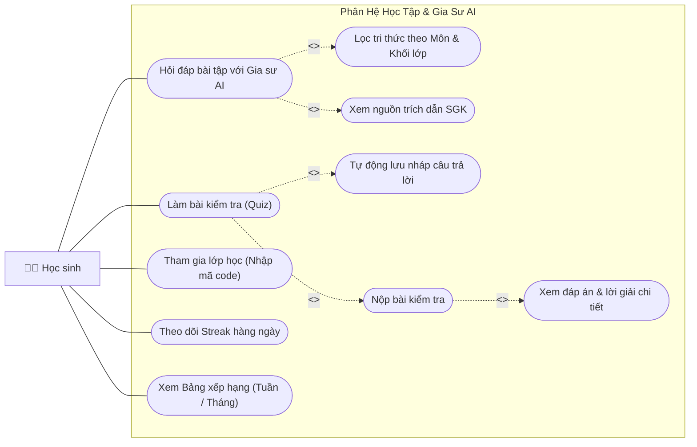
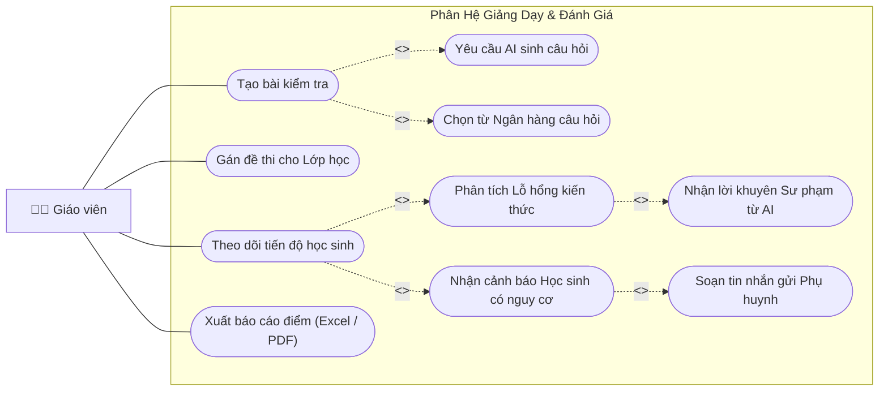
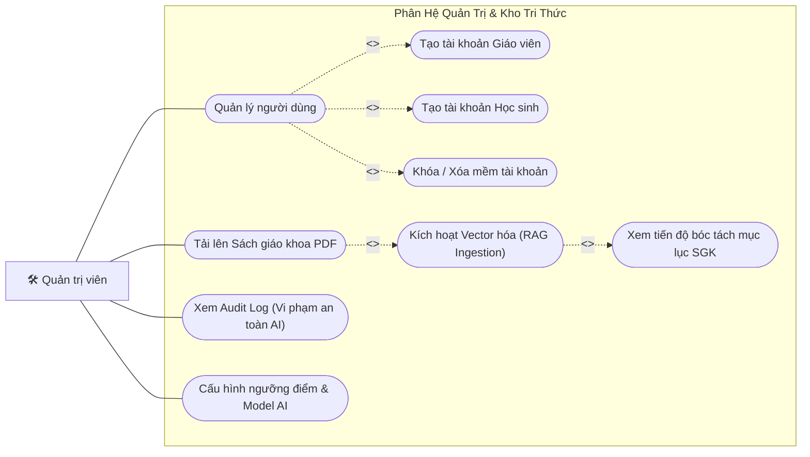
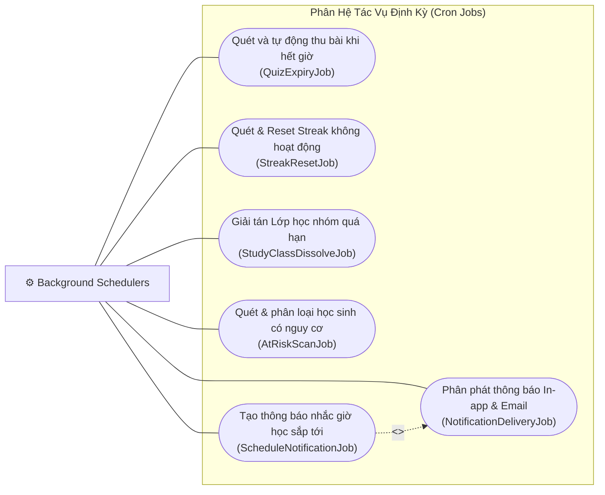

# Sơ Đồ Use Case Toàn Diện (Comprehensive Use Case Documentation) - AI Tutor

Tài liệu này định nghĩa toàn bộ **Tác nhân (Actors)** và **Sơ đồ Use Case (Use Case Diagrams)** của nền tảng **AI Tutor**, bao gồm mối quan hệ tương tác giữa người dùng và các chức năng của hệ thống `ai-tutor-service`.

---

## 1. Danh Sách Tác Nhân (Actors)

| Icon | Tác nhân (Actor) | Vai trò & Trách nhiệm |
| :---: | :--- | :--- |
| 🧑‍🎓 | **Học sinh (Student)** | Người dùng cuối học tập: Hỏi đáp với Gia sư AI, làm bài trắc nghiệm, theo dõi chuỗi ngày học (Streak), điểm thưởng XP và bảng xếp hạng. |
| 👨‍🏫 | **Giáo viên (Teacher)** | Người quản lý lớp học và giảng dạy: Quản lý học sinh, ngân hàng đề thi, yêu cầu AI sinh câu hỏi, theo dõi lỗ hổng kiến thức và cảnh báo học sinh có nguy cơ tụt lại. |
| 🛠️ | **Quản trị viên (Admin)** | Người vận hành hệ thống: Quản lý tài khoản (CRUD Giáo viên/Học sinh), nạp dữ liệu tri thức sách giáo khoa (RAG Ingestion), cấu hình hệ thống và giám sát nhật ký an toàn. |
| ⚙️ | **Hệ thống (System Scheduler / Worker)** | Tác nhân nội tại thực thi các tác vụ định kỳ: Thu bài hết hạn, reset streak 00h, tính toán nguy cơ học lực, giải tán lớp học nhóm và gửi thông báo tự động. |

---

## 2. Sơ Đồ Use Case Tổng Quan (System Overview Use Case Diagram)

```mermaid
flowchart LR
    %% Actors
    Actor_Student["🧑‍🎓 Học sinh<br/>(Student)"]
    Actor_Teacher["👨‍🏫 Giáo viên<br/>(Teacher)"]
    Actor_Admin["🛠️ Quản trị viên<br/>(Admin)"]
    Actor_System["⚙️ Hệ thống<br/>(Schedulers / Workers)"]

    subgraph SystemBoundary["HỆ THỐNG AI TUTOR (ai-tutor-service)"]
        %% Common Use Cases
        UC_Auth(["Xác thực & Quản lý phiên<br/>(Đăng nhập / Refresh / Đổi MK)"])
        UC_Profile(["Quản lý hồ sơ cá nhân"])
        UC_ViewNotif(["Xem thông báo cá nhân"])

        %% Student Use Cases
        UC_ChatAI(["Hỏi đáp bài học với Gia sư AI<br/>(RAG Streaming bám SGK)"])
        UC_TakeQuiz(["Làm bài kiểm tra & Luyện tập"])
        UC_EnrollClass(["Tham gia Lớp học nhóm<br/>(Bằng mã ghi danh)"])
        UC_ViewGamification(["Xem tiến độ học tập<br/>(XP, Streak & Leaderboard)"])
        UC_ViewSchedule(["Xem thời khóa biểu & Lịch học"])

        %% Teacher Use Cases
        UC_ManageClass(["Quản lý Lớp học & Học sinh"])
        UC_ManageBank(["Quản lý Ngân hàng câu hỏi"])
        UC_GenAIQuiz(["Yêu cầu AI sinh câu hỏi tự động"])
        UC_CreateAssignQuiz(["Tạo & Gán đề kiểm tra cho lớp"])
        UC_ViewAnalytics(["Phân tích học tập & Lỗ hổng kiến thức"])
        UC_AtRiskAlert(["Xem cảnh báo học sinh nguy cơ"])
        UC_PedagogyAdvice(["Nhận tư vấn sư phạm từ AI"])
        UC_AlertParent(["Soạn & gửi thông báo phụ huynh"])
        UC_ExportReports(["Xuất báo cáo điểm (Excel/PDF)"])

        %% Admin Use Cases
        UC_AdminUsers(["Quản lý Người dùng<br/>(Tạo GV/HS, Khóa, Xóa mềm)"])
        UC_AdminCurriculum(["Quản trị Tri thức SGK<br/>(Upload & RAG Ingestion)"])
        UC_AdminConfig(["Cấu hình tham số hệ thống"])
        UC_AdminAudit(["Xem Nhật ký & Audit an toàn nội dung"])

        %% System Internal Use Cases
        UC_JobExpiry(["Tự động thu bài kiểm tra quá hạn"])
        UC_JobStreak(["Reset Streak học tập lúc 00:00"])
        UC_JobDissolve(["Tự động giải tán lớp hết hạn"])
        UC_JobDispatch(["Động cơ phân phát thông báo đa kênh"])
        UC_JobScanRisk(["Quét định kỳ học sinh nguy cơ"])
    end

    %% Actor to Common
    Actor_Student --- UC_Auth
    Actor_Teacher --- UC_Auth
    Actor_Admin --- UC_Auth
    Actor_Student --- UC_Profile
    Actor_Teacher --- UC_Profile
    Actor_Student --- UC_ViewNotif
    Actor_Teacher --- UC_ViewNotif

    %% Actor to Student Use Cases
    Actor_Student --- UC_ChatAI
    Actor_Student --- UC_TakeQuiz
    Actor_Student --- UC_EnrollClass
    Actor_Student --- UC_ViewGamification
    Actor_Student --- UC_ViewSchedule

    %% Actor to Teacher Use Cases
    Actor_Teacher --- UC_ManageClass
    Actor_Teacher --- UC_ManageBank
    Actor_Teacher --- UC_GenAIQuiz
    Actor_Teacher --- UC_CreateAssignQuiz
    Actor_Teacher --- UC_ViewAnalytics
    Actor_Teacher --- UC_AtRiskAlert
    Actor_Teacher --- UC_PedagogyAdvice
    Actor_Teacher --- UC_AlertParent
    Actor_Teacher --- UC_ExportReports

    %% Actor to Admin Use Cases
    Actor_Admin --- UC_AdminUsers
    Actor_Admin --- UC_AdminCurriculum
    Actor_Admin --- UC_AdminConfig
    Actor_Admin --- UC_AdminAudit

    %% Actor to System Jobs
    Actor_System --- UC_JobExpiry
    Actor_System --- UC_JobStreak
    Actor_System --- UC_JobDissolve
    Actor_System --- UC_JobDispatch
    Actor_System --- UC_JobScanRisk
```

---

## 3. Sơ Đồ Use Case Chi Tiết Từng Phân Hệ

### 3.1. Phân Hệ Học Tập & Gia Sư AI (Dành cho Học Sinh)

---

### 3.2. Phân Hệ Giảng Dạy, Đề Thi & Cố Vấn Sư Phạm (Dành cho Giáo Viên)

---

### 3.3. Phân Hệ Quản Trị Hệ Thống & Tri Thức SGK (Dành cho Admin)

---

### 3.4. Phân Hệ Tự Động Hóa & Tác Vụ Định Kỳ (Hệ Thống / Background Jobs)

---

## 4. Ma Trận Phân Quyền Use Case (Role-Based Access Control)

| Mã Use Case | Tên Use Case | Học sinh | Giáo viên | Quản trị viên | Hệ thống |
| :--- | :--- | :---: | :---: | :---: | :---: |
| **UC-01** | Đăng ký tài khoản mới | ✅ | ❌ | ❌ | ❌ |
| **UC-02** | Đăng nhập / Quên mật khẩu / Đổi mật khẩu | ✅ | ✅ | ✅ | ❌ |
| **UC-03** | Chat hỏi đáp bám sát SGK với Gia sư AI | ✅ | ❌ | ❌ | ❌ |
| **UC-04** | Làm bài kiểm tra, lưu nháp & xem lời giải | ✅ | ❌ | ❌ | ❌ |
| **UC-05** | Nhận điểm kinh nghiệm (XP) & Duy trì Streak | ✅ | ❌ | ❌ | ❌ |
| **UC-06** | Xem Bảng xếp hạng (Leaderboard) | ✅ | ✅ | ✅ | ❌ |
| **UC-07** | Nhập mã tham gia Lớp học nhóm (StudyClass) | ✅ | ❌ | ❌ | ❌ |
| **UC-08** | Yêu cầu AI sinh câu hỏi từ bài học | ❌ | ✅ | ✅ | ❌ |
| **UC-09** | Quản lý Ngân hàng câu hỏi & Tạo đề thi | ❌ | ✅ | ✅ | ❌ |
| **UC-10** | Gán bài kiểm tra cho Lớp học | ❌ | ✅ | ❌ | ❌ |
| **UC-11** | Xem phân tích Lỗ hổng kiến thức & Cảnh báo nguy cơ | ❌ | ✅ | ✅ | ❌ |
| **UC-12** | Nhận tư vấn sư phạm từ AI & Soạn tin gửi phụ huynh | ❌ | ✅ | ❌ | ❌ |
| **UC-13** | Xuất báo cáo kết quả học tập (Excel/PDF) | ❌ | ✅ | ✅ | ❌ |
| **UC-14** | Quản lý Người dùng (Tạo, Sửa, Khóa, Xóa mềm) | ❌ | ❌ | ✅ | ❌ |
| **UC-15** | Nạp & Vector hóa Sách giáo khoa (RAG Ingestion) | ❌ | ❌ | ✅ | ❌ |
| **UC-16** | Xem Audit Log an toàn nội dung & Nhật ký lỗi | ❌ | ❌ | ✅ | ❌ |
| **UC-17** | Tự động thu bài thi quá hạn (`QuizExpiryJob`) | ❌ | ❌ | ❌ | ✅ |
| **UC-18** | Tự động reset chuỗi học tập (`StreakResetJob`) | ❌ | ❌ | ❌ | ✅ |
| **UC-19** | Quét và phân phát thông báo đa kênh (`NotificationJob`) | ❌ | ❌ | ❌ | ✅ |

