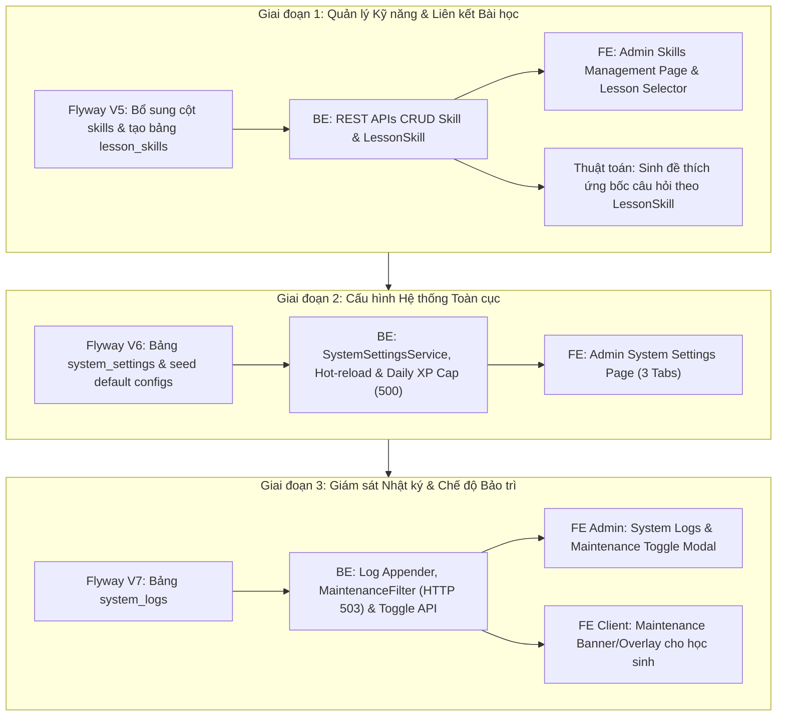

# Báo Cáo Phân Tích Hiện Trạng & Khoảng Trống Triển Khai (Gap Analysis) - Issue 10

> **Tài liệu căn cứ:** [docs/iss10.md](iss10.md) (*User Story: Quản lý Kỹ năng thích ứng và Cấu hình Hệ thống - Skills & System Settings*)  
> **Ngày phân tích:** 13/10/2026  
> **Đối tượng:** Quản trị viên hệ thống (Admin) / Chuyên gia giáo dục (Academic Admin)  
> **Phạm vi kiểm tra:** Toàn bộ mã nguồn `ai-tutor-service` (Backend Spring Boot), `ai-tutor-frontend` (Frontend React/Vite), và CSDL PostgreSQL `ai_tutor_dev`.

---

## 📌 I. Tổng quan & Bối cảnh Nghiệp vụ (Overview & Context)

Hệ thống AI Tutor hướng đến mục tiêu **học tập thích ứng (Adaptive Learning)**, nghĩa là tự động chẩn đoán năng lực học sinh và đề xuất câu hỏi/bài học phù hợp. Để hiện thực hóa mục tiêu này, hệ thống cần:
1. **Bản đồ Kỹ năng thích ứng (Skill Map):** Định nghĩa chi tiết các kỹ năng, kèm các tham số thuật toán chẩn đoán (độ quan trọng, ngưỡng thành thạo, số lượt làm bài tối thiểu, cho phép bỏ qua).
2. **Liên kết Bài học - Kỹ năng (`LessonSkill`):** Gắn các kỹ năng vào từng bài học cụ thể trong sách giáo khoa để AI sinh đề thi đúng trọng tâm bài học.
3. **Cấu hình Hệ thống toàn cục (System Settings):** Cho phép Admin điều chỉnh hạn mức XP ngày, cấu hình AI Model (API keys, model, temperature), tham số Redis/DB mà không cần sửa code hay can thiệp trực tiếp vào database.
4. **Nhật ký lỗi & Chế độ bảo trì (System Logs & Maintenance):** Theo dõi nhật ký lỗi hệ thống tập trung (Error Stack Trace) và kích hoạt chế độ bảo trì chặn API client khi cần nâng cấp hạ tầng.

---

## 📊 II. Bảng đối chiếu tổng hợp (Summary Gap Analysis)

| Phân hệ / User Flow | Tiêu chí trong `iss10.md` | Hiện trạng hệ thống hiện tại | Đánh giá |
| :--- | :--- | :--- | :---: |
| **1. Quản lý Kỹ năng (Skill CRUD)** | • CRUD kỹ năng đầy đủ qua UI. • Thuộc tính thuật toán: `importance` (1-10), `mastery_threshold` (0.0-1.0), `min_attempts` (1-100), `can_skip` (boolean). • Validation mã kỹ năng, ngưỡng thành thạo (AC-SYS-01). | • Đã có bảng `skills` với thông tin cơ bản (`name`, `code`, `subject`, `grade_level`, `description`). • Backend chỉ có duy nhất 1 API `GET /api/v1/skills`. • Chưa có các trường thuật toán trong CSDL & Entity. • Chưa có API Create/Update/Delete. • Chưa có giao diện quản lý kỹ năng trong Admin. | 🟡 **Đáp ứng 15%** *(Chỉ có entity cơ bản, thiếu logic & UI)* |
| **2. Liên kết Kỹ năng - Bài học (`LessonSkill`)** | • Bảng liên kết trung gian `lesson_skills`. • UI tích chọn gán bài học vào kỹ năng. • Thuật toán Adaptive Quiz bốc câu hỏi theo kỹ năng đã liên kết với bài học (AC-SYS-02). | • Đã có bảng `lessons` và `question_bank` (có `skill_id`). • **Chưa có bảng `lesson_skills`**. • Chưa có API liên kết bài học. • Chưa có giao diện gán bài học. • Sinh đề thi chưa bốc câu hỏi theo kỹ năng liên kết của bài học. | 🔴 **Chưa làm được (0%)** |
| **3. Cấu hình Hệ thống (System Settings)** | • Quản lý cấu hình toàn cục qua 3 tabs: Gamification (Daily XP Cap 500), AI Model (Key, Model, Temp), Cache/DB Pool. • Lưu DB và Hot-reload runtime không cần restart server. | • Cấu hình AI Model, Redis, DB đang hardcode hoặc cố định trong file `application.yml` / biến môi trường. • XP thưởng đang cộng tự do, chưa có giới hạn Daily XP Cap. • Chưa có bảng `system_settings` trong DB. • Chưa có API và UI System Settings (sidebar chỉ có mục placeholder bị disable). | 🔴 **Chưa làm được (0%)** |
| **4. Giám sát Logs & Chế độ Bảo trì** | • System Logs: Bộ lọc Level (Info, Warning, Error, Critical), lọc theo ngày, xem chi tiết Stack Trace. • Chế độ bảo trì: Modal xác nhận, đổi trạng thái `MAINTENANCE`, Interceptor chặn API học sinh (503), client hiển thị màn hình bảo trì (AC-SYS-03). | • Đã có bảng `audit_logs` lưu vết cơ bản (`user_id`, `action`, `details`). • Chưa có bảng `system_logs` lưu lỗi runtime. • Chưa có cơ chế bảo trì Maintenance Mode phía Backend (chưa có Filter chặn API). • Chưa có UI System Logs và Maintenance overlay phía Frontend. | 🔴 **Chưa làm được (5%)** *(Chỉ có audit log sơ khai)* |

---

## 🔍 III. Phân tích Chi tiết từng Phân hệ

### 1. Phân hệ Quản lý Kỹ năng thích ứng (Skill CRUD Flow - AC-SYS-01)

#### 1.1. Yêu cầu đặc tả trong `iss10.md`
* **Mã kỹ năng (`code`):** Bắt buộc, 2-20 ký tự, chữ cái/số không dấu, tự động viết hoa, duy nhất trên toàn hệ thống.
* **Tên kỹ năng (`name`):** Bắt buộc, Unicode, 2-100 ký tự.
* **Mô tả (`description`):** Tùy chọn, tối đa 500 ký tự.
* **Độ quan trọng (`importance`):** Bắt buộc, số nguyên 1 - 10, mặc định: 1.
* **Ngưỡng thành thạo (`mastery_threshold`):** Bắt buộc, số thập phân 0.00 - 1.00, mặc định: 0.90 (90%).
* **Số lượt thử tối thiểu (`min_attempts`):** Bắt buộc, số nguyên 1 - 100, mặc định: 3 câu.
* **Cho phép bỏ qua (`can_skip`):** Bắt buộc, boolean, mặc định: false.
* **Chức năng Admin:** Xem danh sách, tìm kiếm theo Tên/Mã, lọc theo Môn học, Khối lớp, Thêm mới, Sửa, Xóa.
* **Tiêu chí AC-SYS-01:** Chặn trùng mã, chặn `mastery_threshold` ngoài khoảng `[0.0, 1.0]`.

#### 1.2. Hiện trạng Backend (`ai-tutor-service`)
* ✅ **Đã có:**
  * Bảng PostgreSQL `skills` đã tồn tại, có các cột `id`, `name`, `code` (Unique), `subject`, `grade_level`, `description`.
  * Entity [Skill.java](file:///d:/aaa/AI-tutor-/ai-tutor-service/src/main/java/com/vn/aitutor/entity/Skill.java), [SkillRepository.java](file:///d:/aaa/AI-tutor-/ai-tutor-service/src/main/java/com/vn/aitutor/repository/SkillRepository.java), [SkillService.java](file:///d:/aaa/AI-tutor-/ai-tutor-service/src/main/java/com/vn/aitutor/service/SkillService.java).
  * API `GET /api/v1/skills` lấy toàn bộ kỹ năng.
* ❌ **Chưa có:**
  * Thiếu 4 trường thuật toán trong CSDL: `importance`, `mastery_threshold`, `min_attempts`, `can_skip`.
  * Thiếu DTO request: `SkillCreateRequest`, `SkillUpdateRequest`.
  * Thiếu validation kiểm tra ràng buộc nghiệp vụ (AC-SYS-01): `0.0 <= mastery_threshold <= 1.0`, mã tự động uppercase và validate regex.
  * Thiếu các REST API:
    * `POST /api/v1/skills`: Thêm kỹ năng mới.
    * `PUT /api/v1/skills/{id}`: Cập nhật thông tin kỹ năng.
    * `DELETE /api/v1/skills/{id}`: Xóa kỹ năng (xóa liên kết bài học trước khi xóa bản ghi chính).
    * `GET /api/v1/skills/paged`: Phân trang, tìm kiếm theo keyword, lọc theo `subject`, `gradeLevel`.

#### 1.3. Hiện trạng Frontend (`ai-tutor-frontend`)
* ❌ **Chưa có:**
  * Chưa có trang `SkillsManagementPage.tsx` trong thư mục `src/pages/Admin/`.
  * Chưa có menu "Quản lý Kỹ năng" trong [AdminSidebar.tsx](file:///d:/aaa/AI-tutor-/ai-tutor-frontend/src/layouts/AdminLayout/components/AdminSidebar.tsx).
  * Chưa có Modal tạo mới, chỉnh sửa, xác nhận xóa kỹ năng.

---

### 2. Phân hệ Liên kết Kỹ năng vào Bài học (Link Skill to Lesson - AC-SYS-02)

#### 2.1. Yêu cầu đặc tả trong `iss10.md`
* Quản lý liên kết đa-đa giữa Bài học (`Lesson`) và Kỹ năng (`Skill`).
* Tại trang chi tiết kỹ năng, hiển thị danh sách các bài học thuộc cùng môn học và khối lớp.
* Cho phép Admin tích chọn một hoặc nhiều bài học liên kết và nhấn "Cập nhật liên kết".
* **Tiêu chí AC-SYS-02:** Khi học sinh mở làm bài tập hoặc tạo đề thi tự luyện của Bài học $B$, hệ thống Adaptive Quiz phải bốc câu hỏi từ ngân hàng câu hỏi (`question_bank`) thuộc các kỹ năng đã liên kết với Bài học $B$.

#### 2.2. Hiện trạng Backend (`ai-tutor-service`)
* ✅ **Đã có:**
  * Bảng `lessons` ([Lesson.java](file:///d:/aaa/AI-tutor-/ai-tutor-service/src/main/java/com/vn/aitutor/entity/Lesson.java)).
  * Bảng `question_bank` có cột `skill_id` liên kết với bảng `skills`.
* ❌ **Chưa có:**
  * **Chưa có bảng trung gian `lesson_skills`** trong PostgreSQL lưu `(lesson_id, skill_id)`.
  * Chưa có Entity `LessonSkill.java` và Repository tương ứng.
  * Chưa có REST API:
    * `GET /api/v1/skills/{id}/lessons`: Lấy danh sách bài học đã gán cho kỹ năng.
    * `PUT /api/v1/skills/{id}/lessons`: Cập nhật danh sách bài học liên kết (nhận danh sách `lessonIds`).
    * `GET /api/v1/lessons/{id}/skills`: Lấy danh sách kỹ năng thuộc một bài học.
  * Logic sinh đề thi tự luyện (`StudentQuizService.java` / `QuizGenerationConsumer.java`) hiện đang truy vấn câu hỏi theo topic/chủ đề dạng chuỗi (`findRandomByTopicAndDifficulty`), **hoàn toàn chưa có logic truy vấn câu hỏi qua liên kết `LessonSkill`**.

#### 2.3. Hiện trạng Frontend (`ai-tutor-frontend`)
* ❌ **Chưa có:**
  * Chưa có giao diện "Associated Lessons" trong Admin để Academic Admin tích chọn gán bài học.

---

### 3. Phân hệ Cấu hình Hệ thống Toàn cục (Update System Settings Flow)

#### 3.1. Yêu cầu đặc tả trong `iss10.md`
* Trang **System Settings** gồm 3 tabs:
  * **Tab 1: Cấu hình Gamification:** Hạn mức XP tối đa trong ngày (`Daily XP Cap`, mặc định 500 XP) để chống cày điểm ảo.
  * **Tab 2: Cấu hình AI Model:** Nhập API Key, chọn mô hình mặc định (Gemini 1.5 Flash, GPT-4, Claude), nhiệt độ sáng tạo (`temperature`).
  * **Tab 3: Cấu hình Cache & Database:** Thiết lập thời gian lưu cache Redis (TTL), cấu hình connection pool.
* Lưu cấu hình vào DB và **Hot-reload runtime** phía server mà không cần restart API.

#### 3.2. Hiện trạng Backend (`ai-tutor-service`)
* ❌ **Chưa có:**
  * **Chưa có bảng `system_settings`** trong PostgreSQL để lưu trữ cấu hình dạng key-value hoặc config groups.
  * **Chưa có kiểm soát Daily XP Cap:** Trong `StudentQuizAttemptServiceImpl.java`, hệ thống hiện đang cộng XP trực tiếp vào `Student.totalXp` sau mỗi bài thi mà không tính tổng XP tích lũy trong ngày hôm đó để chặn trần 500 XP.
  * **Chưa có cơ chế cấu hình AI Model động:** AI API Key và Model hiện tại đang đọc tĩnh từ `application.yml` / `System.getenv()`.
  * **Chưa có API:**
    * `GET /api/v1/admin/settings`: Lấy toàn bộ nhóm cấu hình.
    * `PUT /api/v1/admin/settings`: Cập nhật cấu hình và trigger reload service.

#### 3.3. Hiện trạng Frontend (`ai-tutor-frontend`)
* ❌ **Chưa có:**
  * Menu `Cấu hình AI Agent` trong [AdminSidebar.tsx](file:///d:/aaa/AI-tutor-/ai-tutor-frontend/src/layouts/AdminLayout/components/AdminSidebar.tsx) mới chỉ là placeholder dạng disable (`badge: 'Pro'`).
  * Chưa có trang `SystemSettingsPage.tsx` với giao diện 3 tabs như yêu cầu.

---

### 4. Phân hệ Giám sát Nhật ký & Kích hoạt Bảo trì (System Logs & Maintenance - AC-SYS-03)

#### 4.1. Yêu cầu đặc tả trong `iss10.md`
* **Nhật ký lỗi (System Logs):**
  * Hiển thị bảng nhật ký sự kiện, lọc theo Cấp độ log (`INFO`, `WARNING`, `ERROR`, `CRITICAL`), lọc khoảng thời gian (`From Date` ... `To Date`).
  * Bấm xem chi tiết dòng log lỗi kèm `Error Stack Trace`.
* **Chế độ bảo trì (Maintenance Mode - AC-SYS-03):**
  * Admin truy cập trang Maintenance, click "Kích hoạt chế độ Bảo trì" (Trigger Maintenance), có modal cảnh báo xác nhận.
  * Backend chuyển trạng thái hệ thống sang `MAINTENANCE`.
  * Toàn bộ API gọi từ ứng dụng học sinh / mobile bị chặn ngay tại Gateway / Security Filter, trả về mã lỗi bảo trì (HTTP 503).
  * Ứng dụng phía học sinh hiển thị ngay màn hình thông báo: *"Hệ thống đang được nâng cấp bảo trì định kỳ để mang lại trải nghiệm tốt hơn. Vui lòng quay lại sau ít phút! Cảm ơn bạn."*
  * Admin click "Tắt chế độ Bảo trì" để khôi phục hoạt động bình thường.

#### 4.2. Hiện trạng Backend (`ai-tutor-service`)
* ✅ **Đã có:**
  * Bảng `audit_logs` ([AuditLog.java](file:///d:/aaa/AI-tutor-/ai-tutor-service/src/main/java/com/vn/aitutor/entity/AuditLog.java)) lưu các action thông thường của người dùng.
* ❌ **Chưa có:**
  * **Chưa có bảng `system_logs`** trong CSDL lưu log lỗi chuyên biệt (các cột `level`, `message`, `stack_trace`, `source`, `created_at`).
  * Chưa có `LogAppender` hoặc Service ghi lỗi exception vào bảng `system_logs`.
  * Chưa có API đọc logs: `GET /api/v1/admin/logs` (lọc theo level, thời gian, phân trang).
  * **Chưa có cơ chế Maintenance Mode:**
    * Chưa có cờ lưu trạng thái bảo trì trong Redis / DB (`system.maintenance.enabled = true/false`).
    * Chưa có `MaintenanceInterceptor` / `MaintenanceFilter` trong Spring Security để chặn các request `/api/v1/student/**` khi hệ thống đang ở trạng thái bảo trì.
    * Chưa có API bật/tắt bảo trì: `POST /api/v1/admin/maintenance/enable` và `POST /api/v1/admin/maintenance/disable`.

#### 4.3. Hiện trạng Frontend (`ai-tutor-frontend`)
* ❌ **Chưa có:**
  * Menu `Nhật ký bảo mật & Audit` trong [AdminSidebar.tsx](file:///d:/aaa/AI-tutor-/ai-tutor-frontend/src/layouts/AdminLayout/components/AdminSidebar.tsx) đang là placeholder bị disable (`badge: 'Sắp có'`).
  * Chưa có trang `SystemLogsPage.tsx` xem log và stack trace lỗi.
  * Chưa có trang hoặc modal Admin kích hoạt/tắt chế độ bảo trì.
  * Chưa có màn hình Maintenance Overlay trên giao diện học sinh để hiển thị thông báo bảo trì thân thiện khi nhận mã lỗi 503 từ API.

---

## 🛠️ IV. Kế hoạch Kỹ thuật Cần Triển Khai (Technical Implementation Roadmap)

Để hoàn thiện toàn bộ User Story Issue 10, công việc cần triển khai qua 3 giai đoạn như sau:

### 1. Chi tiết Giai đoạn 1 (Skill Map & LessonSkill)
1. **Database Migration (Flyway V5)**:
   * `ALTER TABLE skills ADD COLUMN importance INTEGER DEFAULT 1 NOT NULL;`
   * `ALTER TABLE skills ADD COLUMN mastery_threshold NUMERIC(3,2) DEFAULT 0.90 NOT NULL;`
   * `ALTER TABLE skills ADD COLUMN min_attempts INTEGER DEFAULT 3 NOT NULL;`
   * `ALTER TABLE skills ADD COLUMN can_skip BOOLEAN DEFAULT FALSE NOT NULL;`
   * `CREATE TABLE lesson_skills (id UUID PRIMARY KEY, lesson_id UUID NOT NULL, skill_id UUID NOT NULL, UNIQUE(lesson_id, skill_id));`
2. **Backend**:
   * Cập nhật `Skill.java`, tạo `LessonSkill.java`.
   * Cập nhật `SkillService.java`, thêm `createSkill`, `updateSkill`, `deleteSkill`, `assignLessons`.
   * Viết `SkillValidationUtils` kiểm tra AC-SYS-01.
   * Cập nhật `QuestionBankRepository` để hỗ trợ truy vấn câu hỏi theo `lesson_id` thông qua `lesson_skills` (AC-SYS-02).
3. **Frontend**:
   * Tạo route `/admin/skills` trong `App.tsx` và thêm menu vào `AdminSidebar.tsx`.
   * Xây dựng trang `SkillsManagementPage.tsx` có bảng kỹ năng, thanh tìm kiếm/bộ lọc, modal tạo/sửa kỹ năng và modal chọn bài học liên kết.

### 2. Chi tiết Giai đoạn 2 (System Settings)
1. **Database Migration (Flyway V6)**:
   * `CREATE TABLE system_settings (key VARCHAR(100) PRIMARY KEY, value TEXT NOT NULL, group_name VARCHAR(50) NOT NULL, description VARCHAR(255), updated_at TIMESTAMPTZ);`
   * Seed mặc định: `daily_xp_cap: 500`, `ai_model: gemini-1.5-flash`, `ai_temperature: 0.7`, `redis_cache_ttl_seconds: 3600`.
2. **Backend**:
   * Tạo `SystemSettingsService` đọc config từ cache Redis và fallback DB; có listener reload config.
   * Sửa logic cộng XP trong `StudentQuizAttemptServiceImpl`: kiểm tra tổng XP đã nhận trong ngày `WHERE submitted_at >= CURRENT_DATE`, nếu đạt 500 XP thì không cộng thêm.
3. **Frontend**:
   * Tạo route `/admin/settings` và trang `SystemSettingsPage.tsx` với 3 tabs: Gamification, AI Model, Cache & Database.

### 3. Chi tiết Giai đoạn 3 (System Logs & Maintenance)
1. **Database Migration (Flyway V7)**:
   * `CREATE TABLE system_logs (id UUID PRIMARY KEY, level VARCHAR(20) NOT NULL, message TEXT NOT NULL, stack_trace TEXT, created_at TIMESTAMPTZ NOT NULL DEFAULT NOW());`
2. **Backend**:
   * Bổ sung `DbLogAppender` (hoặc method bắt exception trong `GlobalExceptionHandler`) ghi log `ERROR` và `CRITICAL` vào bảng `system_logs`.
   * Tạo `MaintenanceService`: lưu trạng thái vào Redis key `system:maintenance_mode`.
   * Tạo `MaintenanceFilter` trong Spring Security: nếu maintenance mode đang bật, chặn tất cả request không phải từ role `ADMIN` và trả về HTTP 503 với JSON `{ "error": "MAINTENANCE_MODE", "message": "Hệ thống đang được bảo trì..." }`.
3. **Frontend**:
   * Trang `SystemLogsPage.tsx` cho Admin: xem bảng log, lọc level, ngày tháng, xem popup Stack Trace.
   * Modal kích hoạt chế độ bảo trì trong Admin Dashboard.
   * Thêm interceptor trong `axios` / `fetch` phía học sinh: khi nhận mã 503, hiển thị trang thông báo bảo trì thân thiện theo AC-SYS-03.

---

## 🏁 V. Kết luận

* Tài liệu `docs/iss10.md` là một User Story **hoàn toàn mới và chưa được hiện thực hóa** trong hệ thống (ngoại trừ cấu trúc bảng `skills` và `audit_logs` ở mức tối giản từ trước).
* Cả **4 phân hệ nghiệp vụ** (CRUD kỹ năng, Liên kết bài học, Cấu hình toàn cục, Giám sát lỗi & Chế độ bảo trì) đều **cần được xây dựng từ Backend đến Frontend**.
* Toàn bộ mã nguồn hiện tại của dự án hoàn toàn sạch sẽ, kiến trúc Spring Boot + React Vite + PostgreSQL sẵn sàng để bắt đầu triển khai Issue 10 theo đúng kế hoạch kỹ thuật trên.
